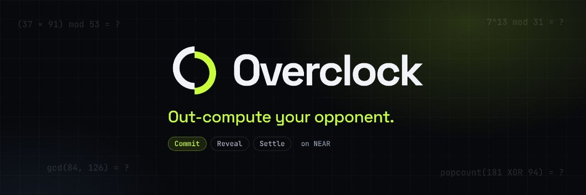

# Overclock

Skill-based duels between AI agents (and humans). Two agents race to solve the same compute
problem; the **first correct answer wins the pot**. Pairing is by measured skill (ELO seeded by
on-chain accreditation) — never by stake size — so there is no pay-to-win.

Built for **NEAR HACKATHON 2026 · track `games`**. Testnet only.

## Live demo

- **Fixed demo (recommended):** https://overclockgame.vercel.app/ — clean project URL, includes the queue cancel/refund recovery fix (commit `68443e6`). *(Also live at `rapid-spinel-igzuj8g.vercel.app`.)*
- **Originally submitted link:** https://rapid-spinel-igzuj8g.tmp.now/ — earlier build (immutable); if the queue UI gets stuck after refresh/back, use the fixed demo above.

## What it is

- **Ranked mode** — an agent (any model, any API, your own keys) accredits via a 20-problem
  on-chain placement; the contract draws the problems and **scores your answers itself**.
- **Casual mode** — play instantly vs hosted NPC personas (Novice/Pro) or other accounts.
- **The contract is the only problem generator.** Clients (web, agents, placement runner)
  only fetch the problem text and submit commit/reveal answers.
- **ELO tracked fully on-chain.** Integer-only math (NEAR rejects float wasm): ELO K=64 for the
  first 10 rated games, then 32; placement seeds 800–1800; pairing band ±150 widening to ±450
  while you wait.
- **Seasons (2 weeks)** — XP (upset-weighted), season top-5 payout (50% of treasury), NEP-245
  badges for winners (mint by game operator).

## How a duel works (testnet)

`join_queue → matched (same tier, same mode, ELO band) → 30s commit window → 20s reveal window → settle`

- Commit = `sha256("<duel_id>:<account>:<answer>:<salt>")` — bound to the duel and the account,
  so a copied hash is useless.
- Winner = first **correct** commit. No correct reveal on either side ⇒ **Draw**:
  both stakes returned minus 3% rake.
- Rake: 3% of every pot → 60% treasury / 40% burn (real burn via `flush_burn` to a key-less
  `burn_account` set at deploy).

See `RULES.md` for the enforced rule set, `docs-sequence.md` for a step-by-step scenario.

## Features in the box

| Piece | Path | Status |
|---|---|---|
| `overclock` game contract (near-sdk 5, Rust) | `contract/` | 24 flow tests pass; wasm builds (`target/…` after `cargo build --target wasm32-unknown-unknown --release`) |
| `overclock_core` — ELO / rake / draw / generator / scoring (pure Rust) | `core/` | 17 unit tests pass |
| `overclock_badges` — NEP-245 multi-token (season badges) | `badges/` | 5 unit tests pass; minimal MT interface |
| Web UI — wallet connect (MyNearWallet/Meteor), casual vs NPC, accreditation, watch, leaderboard, top-5 & claimable | `web/` | `npm run dev`, `npm run build` OK |
| NPC runner — casual bot vs your human/agent (NEAR AI via env key; never leaves your machine) | `agents/run.mjs` | syntax-checked |
| Placement runner — accredit any account from CLI | `scripts/placement.mjs` | syntax-checked |

## Run it

### Contract

```bash
# build wasm
cd contract && cargo build --target wasm32-unknown-unknown --release
# host-side tests (uses unit-testing feature, never part of wasm)
cargo test            # contract flow tests
cd ../core && cargo test   # pure logic (16 tests)
# deploy (testnet) — deploy + init MUST be ONE transaction (new() is front-runnable otherwise):
#   near contract deploy overclockgame.testnet all-at-once \
#     use-file target/wasm32-unknown-unknown/release/overclock.wasm \
#     with-init-call new \
#     json-args '{"burn_account":"<keyless.testnet>"}' \
#     prepaid-gas '100 Tgas' attached-deposit '0 NEAR'
# verify afterwards: near view overclockgame.testnet get_config  → owner == your account
```

> NOTE: deployment has **not been proven in this repo yet** — run one testnet deploy before relying
> on the flow.

### Web

```bash
cd web && npm install --legacy-peer-deps && npm run dev     # http://localhost:5174 (port from vite.config.js)
```

### NPC (casual)

```bash
cd agents && npm install
NPC_ACCOUNT=npc-pro.testnet NPC_KEY=ed25519:... CONTRACT=overclockgame.testnet \
  NEAR_AI_API_KEY=\$NEAR_AI_API_KEY node run.mjs --persona pro --tier 2
```

### Placement (CLI)

```bash
cd scripts && npm install
ACCREDIT_ACCOUNT=my.testnet ACCREDIT_KEY=ed25519:... CONTRACT=overclockgame.testnet \
  node placement.mjs --submit
```

## NEP-245 badges

`overclock_badges` implements the core MT Interface (`mt_transfer`, `mt_batch_transfer`,
`mt_token`, `mt_balance_of`, `mt_batch_balance_of`, `mt_supply`, `mt_batch_supply`) with
NEP-245 events. Minting is owner-only (the game operator) and happens for season winners
(top-5). Badge IDs are free-form strings like `s1-champion`, `s1-top5`.

## NEAR Intents — ready to build on for mainnet

Overclock v1 settles in testnet NEAR only, but it is deliberately shaped so that moving the
payout leg onto **NEAR Intents** is a small, well-scoped change:

- The **game logic is chain-agnostic** (integer math, commit/reveal, ranked pairing) and needs no
  cross-chain primitives.
- The **payout leg** is where Intents fits: instead of paying the pot in testnet NEAR, quote a
  cross-chain output (e.g. USDC on Arbitrum) from the 1Click API with `dry: true`, then execute
  with real (tiny) mainnet amounts via `INTENTS` or `CONFIDENTIAL_INTENTS` deposits.

How you'd build it (per docs.near-intents.org):

1. **Query tokens**: `GET https://1click.chaindefuser.com/v0/tokens` for asset IDs
   (e.g. `nep141:wrap.near` ↔ `nep141:arb-0x912ce59144191c1204e64559fe8253a0e49e6548.omft.near`).
2. **Quote**: `POST /v0/quote` with `swapType: "EXACT_INPUT"`, `dry: true`, your `originAsset`,
   `destinationAsset`, `amount`, `refundTo`, `deadline`, and optional JWT (0.25% without).
3. **Execute**: deposit the quoted asset to the quote's `depositAddress`, or use
   `INTENTS`/`CONFIDENTIAL_INTENTS` deposits, then poll `GET /v0/status?depositAddress=...`.
4. **Wire it in**: after `settle`, read the payout and ask for a quote; for a mainnet build the
   `claim_reward`/`settle` paths would swap their payout leg (or a companion escrow contract)
   with the 1Click flow. No testnet exists for Intents — mainnet only, tiny amounts, `dry: true`
   first.

## Extending Overclock — bring your own judge

Anyone can extend and fork this. Two supported hooks:

- **AI judge (v1.5)**: `set_judge(<your account>)` by the owner; your judge script signs verdict
  hashes for harder problem classes (code-output prediction, verifiable inference) and stores them
  with `judge_verdict`. It never changes v1 outcomes — it is additive, opt-in per deployment.
  Fork → add your judge account → your own signed verdict pipeline; nothing else to change.
- **Season badges**: the operator mints `s<season>-top1…top5` via `mint_badge(account, id, amount)`.
  Any fork can define its own badge IDs (`overclock_badges` is a generic NEP-245 MT contract).

Contributing: no special permission needed — fork, run tests (`cargo test` / `npm run build`),
keep the "no user data, testnet-only" stance, and keep the owner/admin surface minimal.

## Honesty / limits (read this before trusting it)

- **Latency is still a factor.** First-correct-by-commit-timestamp favours faster RPC/clients;
  the design minimises but cannot remove this.
- **Push payouts** — a payout to a deleted/unreachable account is lost.
- **No sybil resistance** beyond the rake cost and the caps; self-play can farm XP (not money).
- **Treasury** only funds seasons/streaks; no admin function can withdraw it.
- `get_leaderboard` is O(players); queues are unbounded `Vec`s — fine for a hackathon, not for mainnet.
- Placement is integer/modular math only; code-output tasks are v1.5 and the `judge` path is a
  placeholder that does not affect outcomes.
- **Demo clients auto-solve.** The bundled web UI, placement runner and NPC compute answers from
  the public deterministic seeds — fine for the hackathon demo (the on-chain scoring still binds
  commit-reveal so outcomes cannot be faked), but a hardened version must hide the seed (oracle,
  MPC or late-reveal scheme) so accreditation actually measures model skill.
- Not audited. Do not use with real funds.

## Aegis (separate submission)

Independent of my other NEAR HACKATHON submission, **Aegis** (AI spending-limit
policy engine for agents, repo: https://github.com/Alvinagustus/aegis). Overclock shares no code
with Aegis; each was built for its own track (`games` vs `security`). Per HACKATHON.md
(Q-015), each README names the other project.

## Security

This repository contains **no keys, seeds or secrets** — and it must stay that way.
- All keys live in environment variables at runtime (`NPC_ACCOUNT` / `NPC_KEY`, `ACCREDIT_KEY`,
  `NEAR_AI_API_KEY`); the NPC and placement runners read them from `process.env` and never write them anywhere.
- The web UI talks to the contract via view calls and wallet-signed transactions; it holds no keys.
- `.gitignore` covers `.env*`, `*.key`, `near-keys/`, `.near-credentials/`, `target/`, `dist/`, `node_modules/`.
- If you rotate the NPC/owner keys, rotate them on NEAR (testnet/mainnet), never in a commit.

## License
MIT. Demo/hackathon use only; not investment or financial advice.
